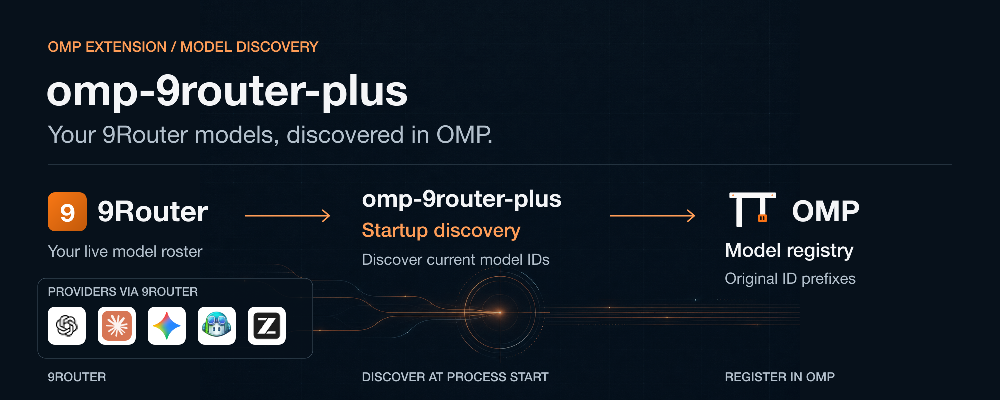

# omp-9router-plus



An OMP extension that discovers models from your 9Router server at startup and
registers them under the `9router` provider. Model IDs keep their original
prefixes. The extension does not manage the server or maintain its own roster.

## Requirements

- OMP (`@oh-my-pi/pi-coding-agent`) 18.20.0.
- Bun 1.4.4 or newer.
- A running [9Router](https://github.com/decolua/9router) server and API key.

Verified on macOS arm64. Other platforms have not been verified.

## Quick start

Install the extension from npm:

```sh
omp install omp-9router-plus
```

Restart OMP after installation.

Add the following to `models.yml` in the active OMP agent directory, normally
`~/.omp/agent/models.yml` on the tested platform. Profiles or an agent directory
override can change that location. Merge it with existing providers:

```yaml
providers:
  9router:
    baseUrl: http://localhost:20128/v1
    api: openai-completions
    apiKey: NINE_ROUTER_API_KEY
```

Use your server's OpenAI-compatible API base URL, including `/v1` for standard
9Router installations. Change the example localhost address if your server
listens elsewhere; the dashboard URL is not the API base URL.

Before starting OMP, enter your actual server key without putting it in shell
history, export it, and start OMP from the same shell:

```sh
read -rs 'NINE_ROUTER_API_KEY?9Router API key: '
export NINE_ROUTER_API_KEY
omp
```

This prompt uses zsh syntax. The extension does not automatically load `.env`
files. In OMP, open `/models`, find the `9router` provider, and select a
discovered model. Restart OMP to discover roster changes.

## Configuration

Only `baseUrl`, `apiKey`, and `api` are supported under `providers.9router`.
The API is `openai-completions`; the HTTP(S) base URL must not contain
credentials, a query, or a fragment. Keyless operation is not supported.

OMP resolves `apiKey` as an environment variable name, falling back to the
literal string if the variable is unset or empty. An unset reference can
therefore cause a 401 instead of a missing-key error. A literal key is also
supported, but avoid sharing it. A raw `apiKey` beginning with `!` is rejected
rather than executed; an environment value beginning with `!` is treated as a
literal secret.

The configured key is used for discovery. Native `--api-key` overrides the
host completion request only, not discovery. OMP resolves the configured
value again for completion requests, so a changed environment can change the
credential used later.

<details>
<summary>Discovery, capabilities, and metadata</summary>

Each new OMP process discovers a fresh roster. With the supported connection-only
configuration, discovery failure does not restore a stale 9Router roster, and
other providers remain available. In-process hot reload is not guaranteed.

Discovery tries `baseUrl + /models`, then `/model`, then `baseUrl`, stopping at
the first nonempty result. It makes at most three attempts, with a 5-second
timeout per attempt, a 5 MiB response limit, and at most 2,000 model records.
Same-origin redirects are bounded; credentials are not forwarded to another
origin.

Only live IDs become models. Live capability values, including `false`, take
precedence over the reviewed catalog. The pinned catalog supplies reasoning
information when live metadata is missing; its current data has no tools,
vision, or PDF capability fields. Tools and vision require explicit live
`true`, otherwise they default to `false`. The tested OMP model input supports
text and image, not native PDF input; PDF is not treated as an image.

Optional models.dev metadata enriches limits and costs, not capabilities. Its
24-hour cache is under `~/.cache/omp-9router-plus/` in `models.dev.api.json`
and `models.dev.models.json`; it contains neither the 9Router roster nor server
credentials. Metadata failures are nonfatal. Without a complete limit pair,
the fallback is a 32768-token context window and 4096-token maximum output.
Missing cost fields default to zero, meaning unknown or unpriced, not
necessarily free.

</details>

<details>
<summary>Thinking controls</summary>

Use OMP's native thinking controls. Available levels come from live metadata
or the reviewed catalog. Models without a known thinking mapping do not receive
additional levels. OMP handles defaults and level clamping; the upstream provider
determines how each reasoning setting is applied.

</details>

## Limitations

- Model availability and capabilities depend on your 9Router server and upstream
  providers. Discovery does not send a chat request to test each model.
- Custom SDK `modelsPath` and broker mode are outside the supported configuration.
- This extension does not manage 9Router, create API keys, or load `.env` files.

## Troubleshooting

- `invalid-api-key`: `apiKey` is missing or empty. Set a nonempty config value
  and export the referenced variable with your actual key before starting OMP.
- `unsupported-provider-key`: remove manual `models`, `discovery`,
  `modelOverrides`, auth, or other extra keys from `providers.9router`. The
  extension leaves existing configuration unchanged. Remove conflicting settings
  before restarting OMP to use automatic discovery.
- `command-api-key`: replace the raw `!command` with an environment variable
  name or literal key. The extension does not run commands.
- 401: check the server key and the environment of the OMP process. An unset
  environment reference becomes a literal, and `--api-key` does not fix discovery.
- Timeout or no models: check that 9Router is running, the `/v1` URL is reachable,
  and the server returns a nonempty model list, then restart OMP. Do not paste
  credentials into issue reports.
- Invalid YAML or URL: check `models.yml`, the active agent directory, and the
  connection requirements above. Configuration errors leave other providers usable.

## Development

To install from a local checkout:

```sh
bun install --frozen-lockfile
bun run build
omp install .
```

OMP links the checkout and loads `dist/index.js`. Keep the checkout available,
rebuild after source changes, and restart OMP.

Install dependencies from the lockfile and run the aggregate gate:

```sh
bun install --frozen-lockfile
bun run check
```

The gate runs format check, lint, typecheck, unit tests, build, host-contract
test, integration smoke, and package smoke. Tests use local fixtures and a
loopback router rather than a public 9Router endpoint. Individual scripts are
listed in `package.json`; the contract, integration, and package tests require a
prior build when run separately.

## License and credits

MIT licensed; see [LICENSE](LICENSE) and [NOTICE](NOTICE). This project adapts
[opencode-9router-plus](https://github.com/ricatix/opencode-9router-plus),
building on [mdhb2/opencode-9router-plugin](https://github.com/mdhb2/opencode-9router-plugin).
The reviewed catalog data comes from [decolua/9router](https://github.com/decolua/9router).
